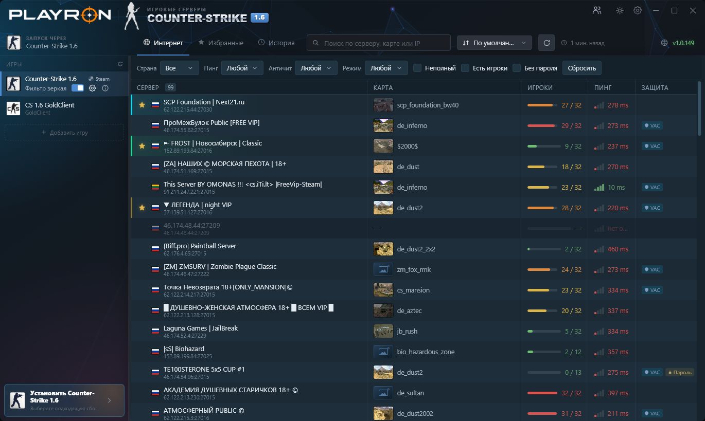

# PLAYRON

[English](#english) · [Русский](#русский)

## English

I built PLAYRON for a simple reason: I wanted to open one window, see which Counter-Strike 1.6 servers had players, and join with the copy of CS I already used.

You can sort the list by ping or player count, look for a particular map, and save servers to Favorites. History takes you back to servers you joined through PLAYRON. If you have more than one copy of CS installed, choose which one to use in the game list. Right-click a game to edit its launch options.

### Getting started

1. Open [Releases](https://github.com/toleanero/PLAYRON-Launcher/releases/latest) and download the `PlayronSetup` EXE under **Assets**. You can also get the [installer from the PLAYRON website](https://downloads.playron.ru/PlayronSetup.exe).
2. Run the installer. PLAYRON runs on 64-bit Windows 10 (1809 or later) and Windows 11. If Microsoft Edge WebView2 is missing, the installer can set it up.
3. Select your installed copy of CS 1.6, then pick a server. The [web server list](https://servers.playron.ru/servers) is also available if you just want to see what's online.

### Steam mirror filter

Sometimes several entries in the Steam server browser are mirrors that send players to the same server. If you use the Steam version of CS 1.6, you can turn on **Фильтр зеркал** next to Steam in the game list. Windows asks for permission the first time because the filter adds Windows Firewall rules for Steam and CS 1.6. Refresh the server search in the game after turning it on.

PLAYRON checks the signature on its own list of confirmed mirror addresses before applying it. If you want to allow a particular server on your PC, open the gear menu and add its `IP:port` under **Мои исключения**. You can look up blocked addresses in the [public blocklist](https://servers.playron.ru/blacklist) or read the [mirror filter guide](https://servers.playron.ru/mirrors/about).

Thanks to **Ch0wW** for writing up the Windows Firewall approach that helped me build this filter. [Original write-up on GitHub](https://github.com/Ch0wW/goldsrc-fake-servers-firewall#the-solution)

### Help

If something goes wrong, send a message to [PLAYRON support](https://servers.playron.ru/support). Include your PLAYRON version, the CS build you selected, and what happened. If PLAYRON showed a reference code, include that too. You can also discuss updates in the [release thread on the PLAYRON forum](https://playron.ru/forum/threads/3/).

## Русский

Я сделал PLAYRON, чтобы открывать одно окно, видеть, где сейчас играют в Counter-Strike 1.6, и подключаться через ту CS, которой уже пользуюсь.

Серверы можно отсортировать по пингу или числу игроков, найти по карте и сохранить в «Избранное». В «Истории» остаются серверы, на которые ты заходил через PLAYRON. Если установлено несколько сборок CS, выбери нужную в списке игр. Параметры запуска открываются правой кнопкой по игре.

### Как начать

1. Открой [Releases](https://github.com/toleanero/PLAYRON-Launcher/releases/latest) и скачай EXE с названием `PlayronSetup` из раздела **Assets**. Есть и [установщик на сайте PLAYRON](https://downloads.playron.ru/PlayronSetup.exe).
2. Запусти установщик. Нужна 64-битная Windows 10 версии 1809 или новее либо Windows 11. Если Microsoft Edge WebView2 ещё нет, установщик предложит его добавить.
3. Выбери установленную CS 1.6 и подключись к серверу. Посмотреть, где сейчас играют, можно и в [списке серверов на сайте](https://servers.playron.ru/servers).

### Фильтр зеркал для Steam

В поиске Steam иногда попадаются зеркала: в списке они выглядят как разные серверы, а при подключении ведут в одно место. Для Steam-версии CS 1.6 можно включить **«Фильтр зеркал»** рядом со Steam в списке игр. При первом включении Windows попросит разрешение на создание правил брандмауэра для Steam и CS 1.6. После этого обнови поиск серверов в игре.

PLAYRON ведёт свой список подтверждённых адресов и проверяет его подпись перед применением. Если хочешь открыть конкретный сервер у себя на ПК, нажми на шестерёнку и добавь его `IP:порт` в **«Мои исключения»**. Проверить адрес можно в [чёрном списке](https://servers.playron.ru/blacklist), а подробнее о работе фильтра написано в [справке о зеркалах](https://servers.playron.ru/mirrors/about).

Спасибо **Ch0wW** за описание способа с брандмауэром Windows. Оно помогло мне сделать фильтр. [Описание способа на GitHub](https://github.com/Ch0wW/goldsrc-fake-servers-firewall#the-solution)

### Куда писать, если что-то не работает

Напиши в [поддержку PLAYRON](https://servers.playron.ru/support). Укажи версию лаунчера, какую сборку CS выбрал и что произошло. Если появился код обращения, приложи его к сообщению. Обсудить обновления можно в [теме на форуме PLAYRON](https://playron.ru/forum/threads/3/).
